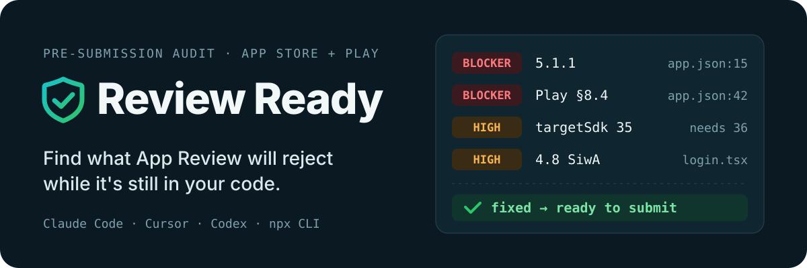
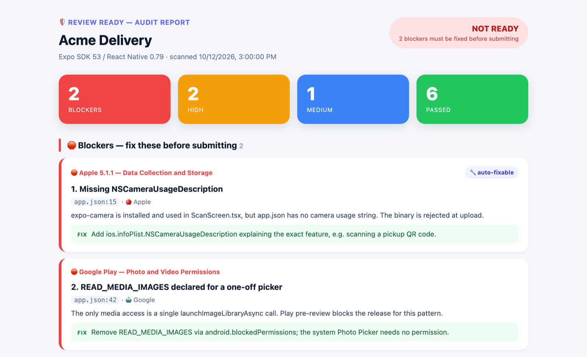
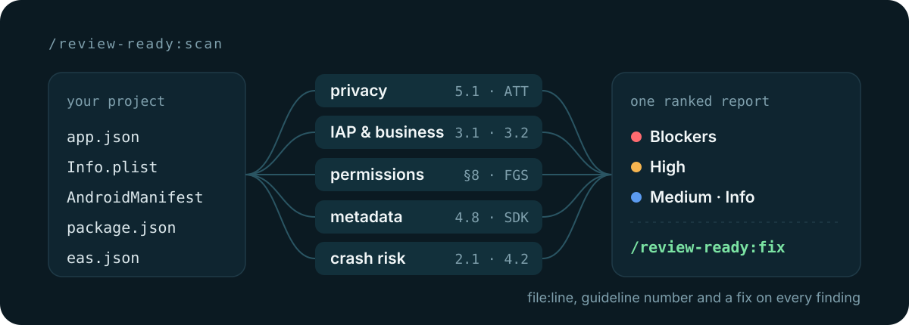

<p align="center">
  
</p>

<p align="center">
  <a href="https://claude.ai/plugins"></a>
  <a href="https://cursor.com/marketplace"></a>
  <a href="https://developers.openai.com/codex/plugins"></a>
  <a href="packages/cli"></a>
  
  
</p>

Review Ready scans an iOS, Android, Expo or React Native project against Apple's App Review Guidelines and Google Play's Developer Policy, then tells you what will get rejected, where it lives (`file:line`), which guideline it breaks, and how to fix it. Run it before you hit **Submit for Review**, not after the rejection email.

It's one plugin for **Claude Code**, **Cursor** and **Codex**, plus a no-LLM CLI for CI.

<p align="center">
  
</p>
<p align="center"><sub>The HTML report from a scan of a sample Expo app. It opens in your browser when the scan finishes.</sub></p>

## What it catches

**Apple**
- Missing or generic permission purpose strings (5.1.1), the most common rejection we see
- `PrivacyInfo.xcprivacy` gaps that trigger ITMS-91053 emails
- Third-party login without Sign in with Apple (4.8), including Firebase phone auth
- IAP bypass: Stripe or Razorpay selling digital goods (3.1.1)
- Account creation with no in-app deletion (5.1.1(v))
- B2B apps submitted for public distribution (3.2), saturated-category clones (4.3(b)), anonymous stranger chat (1.2)
- Builds that aren't on Xcode 26 / the iOS 26 SDK, which App Store Connect has rejected at upload since April 28, 2026

**Google Play**
- `targetSdk` below API 36, required for new apps and updates since August 31, 2026
- `READ_MEDIA_IMAGES` on a one-off photo picker, which pre-review blocks outright
- Restricted permissions that need a Play Console declaration (SMS, call log, all-files, background location, contacts)
- `READ_CALL_LOG` used for missed-call phone verification, banned since July 2026
- Foreground services without a `foregroundServiceType`
- 16 KB page-size support, 64-bit ABIs, and Data safety mismatches

Built for Expo and React Native first, with full support for native iOS and native Android projects.

## How it works

<p align="center">
  
</p>

`/review-ready:scan` detects your stack, then runs five auditors in parallel:

| Auditor | Covers |
|---|---|
| `privacy-auditor` | ATT, privacy manifest, purpose strings, account deletion, Data safety, third-party AI disclosure, UGC moderation |
| `iap-business-auditor` | Apple 3.1.1 IAP, Play Billing, subscription disclosure, ad placement |
| `permissions-auditor` | Android restricted permissions, photo picker misuse, foreground service types, prominent disclosure |
| `metadata-auditor` | Bundle IDs, icons, Sign in with Apple, target SDK, Xcode 26 build gate, 3.2 business apps, 4.3 spam |
| `crash-risk-auditor` | Crash patterns, localhost URLs, demo credentials, minimum functionality |

Each auditor reads a knowledge base in [`rules/`](rules), which includes [`real-rejections.md`](rules/real-rejections.md): verbatim rejection emails from real submissions, alongside the published guideline text.

## Install

**Claude Code**

```bash
/plugin install review-ready
# or locally
git clone https://github.com/manthanmk66/review-ready ~/.claude/plugins/review-ready
```

Restart Claude Code afterwards.

**Cursor**: Settings → Plugins → Add from GitHub → `https://github.com/manthanmk66/review-ready`, or install it from the [Cursor Marketplace](https://cursor.com/marketplace).

**Codex**

```bash
/plugin marketplace add manthanmk66/review-ready
/plugin install review-ready@review-ready-marketplace
/reload-plugins
```

Codex also picks up [`AGENTS.md`](AGENTS.md) if you clone the repo into a project.

**CLI, no API key**

```bash
npx review-ready-cli
```

The CLI runs the deterministic checks (permissions and metadata) with no LLM. It exits non-zero on blockers and has a `--base` PR mode that only reports newly introduced issues. See [`packages/cli`](packages/cli) for the GitHub Action.

## Commands

| Command | What it does | Time |
|---|---|---|
| `/review-ready:scan` | Full audit with five parallel auditors, a terminal report and an HTML dashboard | a few minutes |
| `/review-ready:precheck` | The ten blockers that matter most, nothing else | ~30 s |
| `/review-ready:fix` | Applies the safe fixes: purpose strings, encryption flag, privacy manifest stub, ATT setup, over-declared Android permissions | seconds |

The plugin also watches edits to `Info.plist`, `PrivacyInfo.xcprivacy`, `AndroidManifest.xml`, `app.json` / `app.config.*`, `eas.json` and `*.entitlements`, and warns you when an edit introduces a compliance problem.

<details>
<summary>Terminal report example</summary>

```
# Review Ready — Audit Report
Acme Delivery · Expo SDK 53 / React Native 0.79 · scanned 2026-10-12

> NOT READY — 2 blockers must be fixed before submitting

| Store  | Blockers | High | Medium | Passed |
|--------|:--------:|:----:|:------:|:------:|
| Apple  | 1        | 1    | 1      | 3      |
| Google | 1        | 1    | 0      | 3      |

## Blockers
1. Missing NSCameraUsageDescription            auto-fixable
   Apple 5.1.1 — Data Collection & Storage · app.json:15
   Fix: add NSCameraUsageDescription to ios.infoPlist
...
```

Add `review-ready-report.html` to `.gitignore` if you don't want to commit the report.

</details>

## Policy coverage

| Source | Current as of |
|---|---|
| Apple App Review Guidelines | June 8, 2026 revision (4.3 spam rewrite, 1.2 anonymous chat, 4.5.3 Live Activities) |
| Apple upload requirements | Xcode 26 / iOS 26 SDK (Apr 28, 2026), iOS 13 minimum deployment target (Sep 9, 2026), new age ratings (Jan 31, 2026) |
| Google Play Developer Policy | July 15, 2026 announcement (call log verification, anonymous chat, developer verification, third-party AI) |
| Google Play technical | Target API 36 (Aug 31, 2026), 16 KB page sizes (May 1, 2026) |

The full knowledge base is in [`rules/ios-guidelines.md`](rules/ios-guidelines.md), [`rules/android-guidelines.md`](rules/android-guidelines.md) and [`rules/expo-rules.md`](rules/expo-rules.md). Changes are logged in the [CHANGELOG](CHANGELOG.md).

## Supported stacks

| Stack | Status |
|---|---|
| Expo (managed and bare) | Supported |
| React Native CLI | Supported |
| Native iOS (Swift / Obj-C) | Supported |
| Native Android (Kotlin / Java) | Supported |
| Flutter | Planned |

## Limitations

A code scan can't see everything a reviewer sees:

- **Console settings.** Privacy nutrition labels, age rating answers, demo accounts and declarations live in App Store Connect and Play Console. The report lists them as manual steps.
- **Judgment calls.** Copycat detection, design polish and asset quality need a human.
- **Runtime behavior.** Crashes, ANRs and performance need a crash reporter such as Sentry or Crashlytics.
- **New policy.** Apple and Google change rules several times a year. Re-check the official docs before a major release.

## Contributing

Issues and PRs are welcome at [github.com/manthanmk66/review-ready](https://github.com/manthanmk66/review-ready).

- **Adding a rule:** edit the matching `rules/*.md` file and the auditor in `agents/` that should check it.
- **Adding a stack:** add `rules/<stack>-rules.md` and extend stack detection in `skills/scan/SKILL.md`.
- **Got a rejection email?** Add it verbatim to `rules/real-rejections.md` with the failing pattern and the fix that worked.

## License

MIT. Knowledge base compiled from Apple's [App Store Review Guidelines](https://developer.apple.com/app-store/review/guidelines/) and Google's [Play Developer Policy Center](https://play.google/developer-content-policy/).
